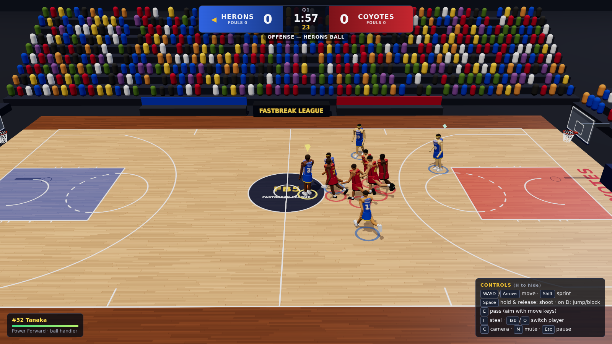

# Fastbreak Five — 3D Basketball in the Browser

A self-contained, playable **3D five-on-five basketball game** that runs in a desktop browser.
You control the **Harbor City Herons** against the AI **Mesa Ridge Coyotes** (both fictional) on a
regulation-scale court, with real ball physics, a timed four-quarter match, fouls and free throws.

**Play it:** https://bh-basketball-v1-claude.seemystuff.workers.dev



## Prerequisites

- Node.js **20+** (developed with Node 26.13) and npm
- A current desktop Chrome or Edge with hardware acceleration (WebGL 2)
- For the E2E tests: Playwright's Chromium (`npx playwright install chromium`)

## Install / run / build / test

```bash
npm install                 # install dependencies
npm run dev                 # dev server at http://localhost:5173
npm run build               # type-check (tsc) + production build into dist/
npm run preview             # serve the production build at http://localhost:4173
npm test                    # unit tests (Vitest): rules, scoring, physics, AI, full headless matches
npm run test:e2e            # browser tests (Playwright) against the built app (starts `vite preview`)
BASE_URL=https://bh-basketball-v1-claude.seemystuff.workers.dev npm run test:e2e   # test the deployment
npm run test:all            # unit tests + build + E2E
```

> **Headless Linux without system Chromium libraries:** if Playwright's browser fails with
> `libnspr4.so: cannot open shared object file`, either install them
> (`sudo npx playwright install-deps chromium`) or, without root, download the packages with
> `apt-get download libnspr4 libnss3 libasound2t64`, extract them with `dpkg-deb -x <deb> <dir>` and
> run the tests with `LD_LIBRARY_PATH=<dir>/usr/lib/x86_64-linux-gnu`.

## Deploy (Cloudflare Workers, static assets)

The game is a static client-only build served by a Worker with static assets (`wrangler.jsonc`).

```bash
export CLOUDFLARE_API_TOKEN=...      # token with Workers edit permission
export CLOUDFLARE_ACCOUNT_ID=...
npm run deploy                       # = npm run build && wrangler deploy
```

The Worker name is `bh-basketball-v1-claude`; the public URL is printed by `wrangler deploy`.
No secrets are bundled into the client; `cloudflare.env` / `.dev.vars` are git-ignored.

## How to play

Click **START GAME** on the menu (choose quarter length, difficulty, camera and graphics first).
The match opens with a **tip-off**: press **Space** when the ball peaks to improve your center's
chance of winning it.

| Action | Keyboard | Gamepad |
|---|---|---|
| Move (camera-relative) | `W A S D` / arrow keys | Left stick |
| Sprint (uses stamina) | `Shift` | RT / RB |
| **Shoot** (with the ball) | hold `Space` (or `J`), **release in the green zone** of the meter | A |
| Jump / block / rebound (without the ball) | `Space` / `J` | A |
| Pass (to the teammate in the held direction; ◆ marker previews the target) | `E` / `K` | B |
| Steal attempt (risk of a reach-in foul) | `F` / `L` | X |
| Switch to the defender nearest the ball | `Tab` / `Q` | Y / LB |
| Toggle broadcast / follow camera | `C` | Back |
| Mute · show/hide controls · FPS overlay | `M` · `H` · `` ` `` (or F3) | |
| Pause / resume | `Esc` / `P` | Start |

**Shooting:** holding Space starts the gather and jump; the meter beside your player fills over
~0.6 s. Releasing at the green band (~90% of the meter) is PERFECT/GOOD; early releases fall short,
late ones go long. Distance, defender contest and fatigue widen the error. Close to the rim
(< 2.6 m) the same button performs a layup. Every shot is a physical ball flight — makes are decided
by the ball passing through the rim, never by a dice roll.

**Rules implemented:** 2- and 3-point field goals (corner and arc), 24-second shot clock (14 after an
offensive rebound off the rim), four configurable quarters (default 2:00), overtime when tied,
out-of-bounds and inbounds, made-basket inbounds from the baseline, steals, interceptions,
blocks, rebounds, shooting fouls (2/3 free throws, and-ones), reach-in fouls, team fouls with a
5-foul bonus, shot-clock violations, and buzzer-beaters (a shot released before 0.0 counts).

## Project layout

```
src/sim/        Pure, deterministic game simulation (no rendering) — unit-testable headless
  constants.ts    court/hoop/ball dimensions (NBA-scale), tuning constants
  ballPhysics.ts  ball integration, floor/rim(torus)/backboard collisions, basket detection, launch solver
  game.ts         authoritative game state: phases, clocks, possession, shooting, passing, fouls, FTs
  ai.ts           AI: ball-handler utility decisions, off-ball spacing/cuts, man-to-man defense, rebounding
  court.ts        3-point geometry, offensive spots, bounds helpers
src/render/     Three.js view: procedural court/arena/hoops/nets, animated player rigs, camera
src/ui/         HUD, menus, keyboard/gamepad input, procedural WebAudio sound effects
tests/unit/     Vitest suites (scoring, possession, clocks, fouls, controls, full headless matches)
tests/e2e/      Playwright browser tests (smoke, controls, scoring via UI, final/restart, reload...)
docs/           screenshots
```

See [BUILD_REPORT.md](BUILD_REPORT.md) for the full build report and requirement checklist and
[ASSETS.md](ASSETS.md) for asset sourcing and licenses.
